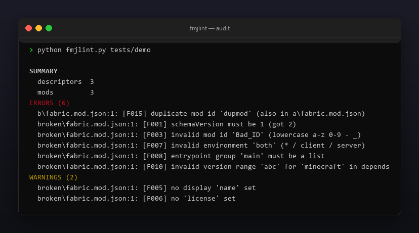
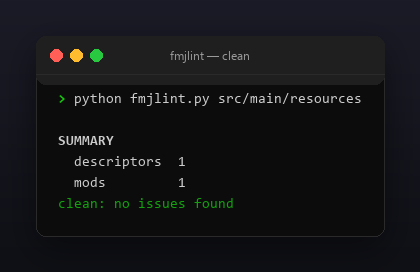

<p align="center"></p>

<p align="center">
  <a href="README.ru.md"></a>
  <a href="https://github.com/Celine1337/fmjlint/releases"></a>
  <a href="https://github.com/Celine1337/fmjlint/actions/workflows/ci.yml"></a>
  <a href="LICENSE"></a>
</p>


Validator for [Fabric](https://fabricmc.net) `fabric.mod.json` descriptors. A
malformed mod metadata file makes Fabric Loader skip or crash your mod with an
opaque error. fmjlint reads `fabric.mod.json` — or a whole mod `.jar` — and
flags the problems before you ship:

- wrong `schemaVersion`, missing / invalid `id` and `version`;
- bad `environment`, malformed `entrypoints` and dependency version ranges;
- entrypoint classes and nested jars that do not exist inside the jar;
- duplicate mod ids across a multi-module tree.

Single file, standard library only, Python 3.9+.


- Validates the Fabric metadata schema fields: `schemaVersion`, `id`, `version`,
  `name`, `license`, `environment`, `entrypoints`, `authors`, `jars`.
- Dependency keys `depends` / `recommends` / `breaks` / `conflicts` with a
  permissive version-range syntax check (`>=`, `~`, `^`, `*`, `x`, `||`, …).
- Three input modes: one descriptor, a directory (duplicate-id detection), or a
  built `.jar` (entrypoint class + nested jar presence).
- `--json` machine-readable report; exit code `1` on errors for CI gating;
  `--strict` also fails on warnings.
- Colored ANSI output, `--no-color` and `NO_COLOR`.


| Code | Severity | Meaning |
|------|----------|---------|
| F000 | error | unreadable file / jar, missing descriptor, or invalid JSON |
| F001 | error | `schemaVersion` must be `1` |
| F002 | error | missing required `id` |
| F003 | error | `id` not lowercase `a-z 0-9 - _` |
| F004 | error | missing required `version` |
| F005 | warning | no display `name` |
| F006 | warning | no `license` |
| F007 | error | `environment` not `*` / `client` / `server` |
| F008 | error | malformed `entrypoints` group or entry |
| F009 | error | entrypoint class not present in the jar |
| F010 | error | malformed dependency map or version range |
| F011 | error | mod depends on itself |
| F013 | error | malformed `authors` entry |
| F015 | error | duplicate mod id across scanned descriptors |
| F016 | warning | same mod in both `depends` and `breaks` |
| F019 | warning | nested jar listed but not present in the jar |


```console
$ python fmjlint.py src/main/resources/fabric.mod.json
$ python fmjlint.py .                      # whole tree, duplicate ids
$ python fmjlint.py build/libs/mymod.jar
$ python fmjlint.py . --json
```

```
SUMMARY
  descriptors  3
  mods         3
ERRORS (6)
  b/fabric.mod.json:1: [F015] duplicate mod id 'dupmod' (also in a/fabric.mod.json)
  broken/fabric.mod.json:1: [F001] schemaVersion must be 1 (got 2)
  broken/fabric.mod.json:1: [F003] invalid mod id 'Bad_ID' (lowercase a-z 0-9 - _)
  broken/fabric.mod.json:1: [F007] invalid environment 'both' (* / client / server)
  broken/fabric.mod.json:1: [F008] entrypoint group 'main' must be a list
  broken/fabric.mod.json:1: [F010] invalid version range 'abc' for 'minecraft' in depends
WARNINGS (2)
  broken/fabric.mod.json:1: [F005] no display 'name' set
  broken/fabric.mod.json:1: [F006] no 'license' set
```

Exit codes: `0` — clean (or warnings only), `1` — errors (or warnings with
`--strict`), `2` — bad path.

Limits, on purpose: version-range checking is syntactic, not a full semver
solver; it cannot know whether a dependency is actually installed.







```console
$ python -m unittest discover -s tests -v
```

22 tests cover every check, jar mode, duplicate ids and exit codes. The demo
tree and all images are regenerable:

```console
$ python tools/make_demo.py       # tests/demo with one of each issue
$ pip install pillow
$ python tools/make_shots.py      # docs/audit.png, docs/clean.png
$ python tools/make_style.py tools/style.json docs/style
```


[MIT](LICENSE) © Celine1337