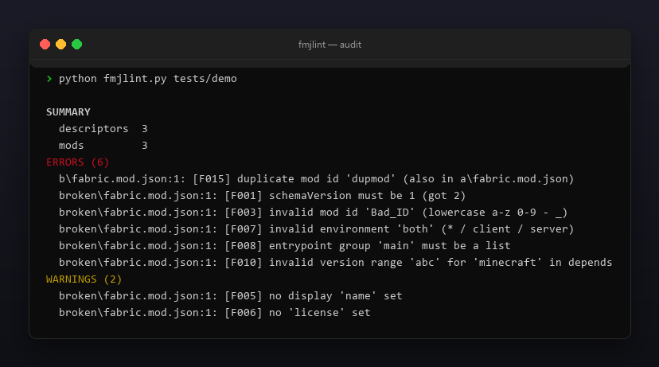
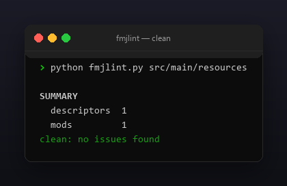

<p align="center"></p>

<p align="center">
  <a href="README.md"></a>
  <a href="https://github.com/Celine1337/fmjlint/releases"></a>
  <a href="https://github.com/Celine1337/fmjlint/actions/workflows/ci.yml"></a>
  <a href="LICENSE"></a>
</p>


Валидатор дескрипторов [Fabric](https://fabricmc.net) `fabric.mod.json`.
Сломанный файл метаданных — и Fabric Loader пропускает или роняет мод с
непонятной ошибкой. fmjlint читает `fabric.mod.json` — или целый `.jar` мода —
и находит проблемы до релиза:

- неверный `schemaVersion`, отсутствующие / невалидные `id` и `version`;
- плохой `environment`, сломанные `entrypoints` и диапазоны версий зависимостей;
- entrypoint-классы и вложенные jar, которых нет внутри jar;
- дубликаты mod id в многомодульном дереве.

Один файл, только стандартная библиотека, Python 3.9+.


- Валидирует поля схемы Fabric: `schemaVersion`, `id`, `version`, `name`,
  `license`, `environment`, `entrypoints`, `authors`, `jars`.
- Ключи зависимостей `depends` / `recommends` / `breaks` / `conflicts` с
  либеральной синтаксической проверкой диапазонов (`>=`, `~`, `^`, `*`, `x`, `||`, …).
- Три режима входа: один дескриптор, каталог (поиск дубликатов id) или
  собранный `.jar` (наличие entrypoint-классов и вложенных jar).
- `--json` — машинный отчёт; код `1` при ошибках для CI-гейта; `--strict`
  валит и на предупреждениях.
- Цветной ANSI-вывод, `--no-color` и `NO_COLOR`.


| Код | Уровень | Смысл |
|-----|---------|-------|
| F000 | ошибка | нечитаемый файл/jar, нет дескриптора или неверный JSON |
| F001 | ошибка | `schemaVersion` должен быть `1` |
| F002 | ошибка | нет обязательного `id` |
| F003 | ошибка | `id` не в нижнем регистре `a-z 0-9 - _` |
| F004 | ошибка | нет обязательного `version` |
| F005 | предупр. | нет отображаемого `name` |
| F006 | предупр. | нет `license` |
| F007 | ошибка | `environment` не `*` / `client` / `server` |
| F008 | ошибка | сломанная группа или запись `entrypoints` |
| F009 | ошибка | entrypoint-класса нет в jar |
| F010 | ошибка | сломанная map зависимостей или диапазон версий |
| F011 | ошибка | мод зависит от себя |
| F013 | ошибка | сломанная запись `authors` |
| F015 | ошибка | дубликат mod id среди дескрипторов |
| F016 | предупр. | один мод и в `depends`, и в `breaks` |
| F019 | предупр. | вложенный jar указан, но отсутствует в jar |


```console
$ python fmjlint.py src/main/resources/fabric.mod.json
$ python fmjlint.py .                      # всё дерево, дубликаты id
$ python fmjlint.py build/libs/mymod.jar
$ python fmjlint.py . --json
```

```
SUMMARY
  descriptors  3
  mods         3
ERRORS (6)
  b/fabric.mod.json:1: [F015] duplicate mod id 'dupmod' (also in a/fabric.mod.json)
  broken/fabric.mod.json:1: [F001] schemaVersion must be 1 (got 2)
  broken/fabric.mod.json:1: [F003] invalid mod id 'Bad_ID' (lowercase a-z 0-9 - _)
  broken/fabric.mod.json:1: [F007] invalid environment 'both' (* / client / server)
  broken/fabric.mod.json:1: [F008] entrypoint group 'main' must be a list
  broken/fabric.mod.json:1: [F010] invalid version range 'abc' for 'minecraft' in depends
WARNINGS (2)
  broken/fabric.mod.json:1: [F005] no display 'name' set
  broken/fabric.mod.json:1: [F006] no 'license' set
```

Коды возврата: `0` — чисто (или только предупреждения), `1` — ошибки (или
предупреждения с `--strict`), `2` — неверный путь.

Ограничения сознательные: проверка диапазонов версий синтаксическая, а не
полный semver-солвер; узнать, установлена ли зависимость реально, он не может.







```console
$ python -m unittest discover -s tests -v
```

22 теста покрывают все проверки, jar-режим, дубликаты id и коды возврата.
Демо-дерево и все картинки перегенерируются:

```console
$ python tools/make_demo.py       # tests/demo с по одной каждой проблеме
$ pip install pillow
$ python tools/make_shots.py      # docs/audit.png, docs/clean.png
$ python tools/make_style.py tools/style.json docs/style
```


[MIT](LICENSE) © Celine1337